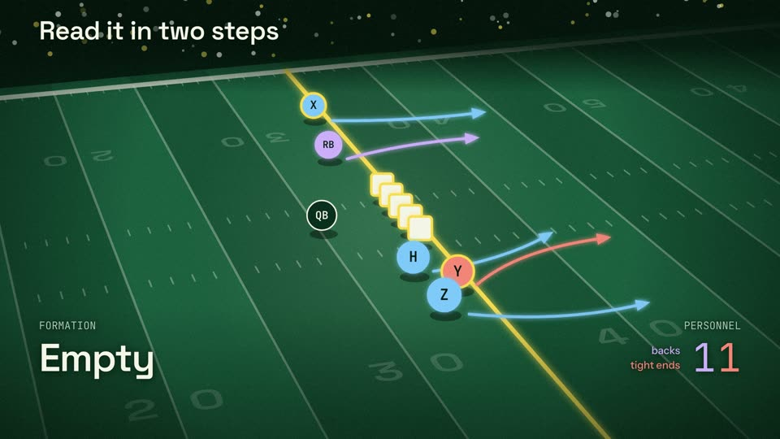
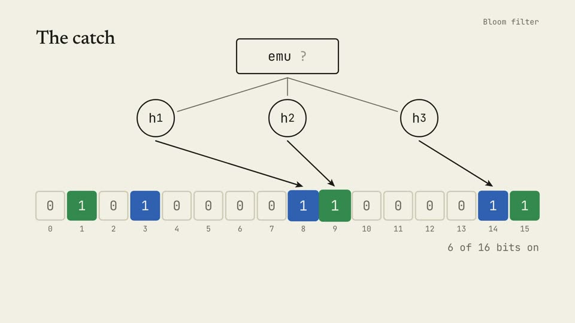

# Explainer video

A Claude Code plugin that turns a code repo, a paper or an idea into a narrated, animated explainer. Claude designs
the explanation, writes and fact-checks the script, animates it so every change lands on a spoken word, records the
narration, synthesizes a music bed, adds captions and renders the MP4.

It holds two skills:

- **explainer-video**: the method, the engine and the whole process, from first question to final render.
- **explainer-video-setup**: checks your Mac for what the first skill needs, installs what is missing (asking
  first), and proves the voice works.

## What it makes

Three finished films, each a worked example in the plugin. Click a frame to download the video.

| | |
|---|---|
| [](https://github.com/ryanhartman4/explainer-video/releases/download/examples-1/formations.mp4) | **How an NFL offense lines up** (3:23). A field drawn in perspective, with a camera that swings between the playbook view and the broadcast angle. [Wide cut](https://github.com/ryanhartman4/explainer-video/releases/download/examples-1/formations.mp4) · [vertical cut](https://github.com/ryanhartman4/explainer-video/releases/download/examples-1/formations-vertical.mp4) |
| [](https://github.com/ryanhartman4/explainer-video/releases/download/examples-1/one-sitting-720p.mp4) | **One Sitting** (3:52). 30,000 points of light become word clusters, the Lorenz attractor, colliding galaxies and the film's own waveform. [720p, 28 MB](https://github.com/ryanhartman4/explainer-video/releases/download/examples-1/one-sitting-720p.mp4) · [full quality, 231 MB](https://github.com/ryanhartman4/explainer-video/releases/download/examples-1/one-sitting.mp4) |
| [](https://github.com/ryanhartman4/explainer-video/releases/download/examples-1/bloom.mp4) | **How a Bloom filter works** (1:28). One row of bits that the whole film is told on. [Video](https://github.com/ryanhartman4/explainer-video/releases/download/examples-1/bloom.mp4) |

All the videos are on the [examples release](https://github.com/ryanhartman4/explainer-video/releases/tag/examples-1).

## What it is made of

**A design method** (`skills/explainer-video/references/method.md`). The film is one picture that builds, not a deck
of slides. The method covers how to find that picture, how to write narration for the ear, the beat sheet that ties
each change on screen to the words that cause it, rules for layout, type, colour and motion with the reasons behind
them, and five tests for reviewing your own frames.

**An engine** (`skills/explainer-video/assets/template/video/stage.js`, about 600 lines, no dependencies). A film is
a pure function of time: one HTML file that opens in any browser with a scrubber, renders repeatably, and
takes all its timing from the narration's word timestamps. Four looks ship with it (a warm paper look, a dark
technical look, the 3Blue1Brown-lineage look of the first five films, and a night look for the 3D layer) with
bundled open-licence fonts.

**A 3D layer** (`skills/explainer-video/assets/stage3d/`, optional, three.js). 30,000 points of light drawn under
the stage, an orbit camera, and ready-made forms: word clusters, the layers of a network, the Lorenz attractor, a
grid of ten thousand cells, colliding galaxies, a sunflower that opens as a flower, a waveform. The same points
become each subject in turn, and labels drawn in 2D follow them. `new_film.mjs --3d` adds it to a project.

**Tools that check the work** (`skills/explainer-video/assets/template/tools/`). `script_check` lints the script and
its pacing before anything is built. `shots` makes contact sheets with the spoken words under each frame. `check`
steps through the film and reports text off the frame, text on text, arrows through labels, unreadable sizes, weak
contrast, dead stretches and missing cues. `render` draws the frames in headless Chrome and encodes with ffmpeg.

**Two options, both off unless you ask for them.** Claude asks at the start of a film and takes no for an answer.
A *vertical cut* is a second film composed for the 1080 by 1920 frame of a phone feed, from the same script, voice
and visual ideas; neither cut is the other rearranged. *Real clips* let a paragraph play a short recording of a real person, credited on screen, in place
of the narrator; the narrator's voice never speaks a real person's words.

**A record of eight films** (`skills/explainer-video/references/playbook.md`): every voice, music and loudness
setting judged by ear, what each fact-check caught, and the original HyperFrames pipeline, which stays as the
back-up engine (`skills/explainer-video/assets/hyperframes/`) for a 3D character or for revising the first five.

**Worked examples** (`skills/explainer-video/assets/demo/`): "How a Bloom filter works" (93 seconds, 2D, one file);
"How an NFL offense lines up" (3:23, a field in perspective with a moving camera, narration written as talk, a wide
and a vertical cut);
"One Sitting" (3:52, 3D, nine scene files built by eight parallel agents, with the brief they worked from); and a
gallery film of the ready-made 3D forms.

The method and the checks are written so that a smaller model can follow them: each step ends in a gate that a tool
decides, and the taste lives in the engine's defaults and the checker's rules more than in prose.

## What you need

- Claude Code, Node 20 or newer, ffmpeg, uv, and Google Chrome (or any Chromium).
- For the free local voice (Breeze TTS 2 on MLX): a Mac with Apple Silicon, about 7 GB of disk. On any other
  machine, narrate with ElevenLabs (an account and an API key), or build the film on placeholder timing and record
  later.
- About 1 GB per film.

## Install

In Claude Code:

```
/plugin marketplace add ryanhartman4/explainer-video
/plugin install explainer-video@explainer-video
```

Restart Claude Code, then ask:

> Set up my Mac for explainer videos.

The setup skill runs a read-only check, then installs only what is missing, asking before each download: Node,
ffmpeg and uv through Homebrew, a locked Python environment for the voice at `~/Developer/mlx-audio`, and the 4.6 GB
voice model. HyperFrames is optional now; it is needed only for the back-up engine.

## Update

In a shell:

```
claude plugin marketplace update explainer-video
claude plugin update explainer-video@explainer-video
```

Then restart Claude Code, or run `/reload-plugins` in an open session. The plugin sets no version number, so Claude
Code tracks this repository's commits and every push to `main` counts as an update.

To bring a film project up to the new engine and tools, run
`node <skill>/scripts/new_film.mjs <project-folder> --update`. It leaves your `SCRIPT.md`, `DESIGN.md` and
`video/film.html` alone.

Then ask for a film:

> Make a two-minute explainer video about how this repo's cache works.

Without the plugin system, copy the two folders in `skills/` into `~/.claude/skills/`.

## The voice

The local voice clones one narrator for every sentence: `skills/explainer-video/assets/voices/w_mid.wav`, a
synthetic voice (not a real person's) used in films 2 to 5. Breeze TTS 2 won a bake-off against OmniVoice, Higgs
TTS 3 and Qwen3-TTS, judged by ear on questions and on words with two readings ("lead", "tear"). The playbook
("Local voice") has the numbers and how to rerun the bake-off when a new model comes out.

Breeze's license allows research and non-commercial use only, and the narrator clip was made with OmniVoice
(CC-BY-NC). That covers personal and unmonetized videos. For a video that earns money, the playbook names the
alternatives.

## Status of version 2

Version 2 (November 2026) moved the default from the HyperFrames pipeline to the method and engine above. What has
and has not been tested:

- The engine, the tools and the demo film were built and rendered on Linux (Node 22, ffmpeg 6.1, Chromium), with the
  music bed, sound hits and mix. The demo passes its own checker.
- Two smaller Claude models each made a short film with the skill from a one-line request (the prompts are kept as
  test cases in `skills/explainer-video/evals/`). Both finished with a clean checker and a rendered MP4, and each
  listed where the instructions or tools tripped it; those places were then fixed. The two films were not made again
  after the fixes.
- On macOS (Apple Silicon) the Bloom demo has been built end to end with the local Breeze voice: checker clean, mix
  at -17.4 LUFS, X master at -16.0 LUFS, sound hits in sync after encoding. Nobody has listened to it yet.
- Rendering the same stretch twice gave identical frames on Linux. On macOS it first differed by a few edge pixels
  with several render pages; the renderer now repaints each frame fully and fixes each page's frame order. That fix
  has not been re-tested on macOS.
- The back-up engine's files were moved, not changed; its set-up command (`new_film.mjs --hyperframes`) has been
  run, but no HyperFrames render has been made from the new layout.

## Licenses and credits

- The skills, scripts, engine and templates in this repo: MIT (see `LICENSE`).
- Bundled fonts (Newsreader, Instrument Sans, Space Grotesk, JetBrains Mono, IBM Plex Mono, KaTeX Main): SIL Open
  Font License 1.1; details in `skills/explainer-video/assets/template/video/assets/fonts/LICENSES.md`.
- Three.js r160 (`skills/explainer-video/assets/hyperframes/vendor/three.min.js`): MIT, its license beside it. The
  first line is patched to remove a deprecation warning.
- The narrator clip: made with OmniVoice (k2-fsa, CC-BY-NC); non-commercial use.
- Downloaded at setup, under their own licenses: Breeze TTS 2 (BreezeBlue, research and non-commercial), mlx-audio
  and its dependencies; for the back-up engine, HyperFrames (HeyGen).
- Claw'd, the character in film 5's back-up template, is fan art of the Claude Code terminal mascot, unaffiliated
  with Anthropic.
